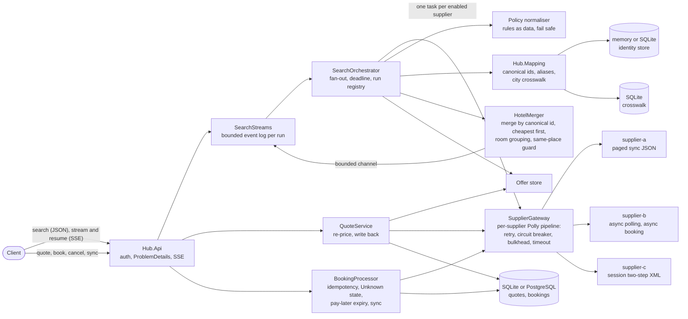

# Hotel Supplier Hub

A multi-supplier hotel aggregation and mapping engine for .NET 10.

Several hotel suppliers with different protocols and response shapes sit behind one provider contract. Their answers are
normalised into a canonical model, mapped to canonical hotel identities, merged across suppliers and streamed to clients as they
arrive. Every supplier call goes through the same resilience pipeline (timeout, retry, circuit breaker, bulkhead), so one slow or
broken supplier never blocks the rest, and partial results are a normal outcome. On top of search the hub quotes and books: a
booking is accepted only against a live quote and the exact amount it showed, bookings are idempotent, and a booking whose outcome
is not known is settled with the supplier instead of being retried. The product surface is an HTTP API with JSON and Server-Sent
Events. There is no front end.

The three suppliers in this repository are in-process fakes with deliberately different shapes. They generate one deterministic
synthetic market in which the same physical hotels appear under different codes, names and prices, so merging is meaningful, and
the whole thing runs without any external credentials or services.

## Architecture



A search runs like this:

1. The tenant's enabled suppliers (in priority order) are intersected with the request's optional `suppliers` filter.
2. Each supplier gets its own task. It resolves the supplier's city codes through the crosswalk, calls the supplier through its
   pipeline and receives hotel batches as they arrive.
3. Each batch is mapped to canonical ids, priced for the tenant (FX and markup), given a canonical cancellation policy, stored as
   offers that can be quoted, and merged. The merger emits `hotelsAdded` for hotels it has not seen and `hotelUpdated` when an
   offer, a source or the cheapest price changes.
4. A supplier that fails or is cut off by the deadline produces `supplierFailed`; the others carry on. The run ends with one
   `completed` event holding the per-supplier outcomes.

A booking runs like this: the client quotes an offer (the supplier re-prices it, a moved price is written back and reported),
then books against the quote id and the exact selling amount with an `Idempotency-Key`. The key and the quote are claimed in one
database transaction, the supplier is asked at most once per claim, and a lost answer makes the booking `unknown`, which is
settled by asking the supplier what it holds. [ADR 7](docs/adr/0007-quotes-and-idempotent-bookings.md) has the details.

The fake suppliers:

| Supplier | Search protocol | Wire format | Booking side |
| --- | --- | --- | --- |
| `supplier-a` | Paged synchronous | camelCase JSON | Availability, prebook, synchronous book, cancel, retrieve. Free-text cancellation policy in several phrasings and date formats; fees as text with a decimal comma. |
| `supplier-b` | Asynchronous polling | snake_case JSON | No prebook (a price is verified through availability). Booking is asynchronous: accepted, then polled to confirmed or failed. Cancel, retrieve. Policy as a date plus a penalty code. |
| `supplier-c` | Session, two steps | XML (`XDocument`) | The search session is required for prebook and book; an expired session is a typed error. Cancel, but no retrieve. Policy as structured tiers. |

All three take a per-supplier fault profile (latency distribution, error rate and kind, malformed payloads, hangs, price drift,
answers lost after the supplier recorded a booking, failing accepted bookings) from configuration and from the admin endpoint,
and all three publish a city and country list for the crosswalk. supplier-b can also send localised overlays.

## Project layout

```
HotelSupplierHub.slnx
src/
  Hub.Abstractions        canonical model, Result<T>, capability-split ports, mapping ports (no dependencies)
  Hub.Core                supplier registry, resilience gateway, orchestrator, merger, run registry, event logs for SSE resume,
                          pricing, offer store, policy normaliser, same-place guard
  Hub.Mapping             identity store (in-memory and EF Core), alias resolver, city crosswalk (matcher, store, service)
  Hub.Booking             quote service, booking processor, background sweeps, EF stores for quotes and bookings
  Hub.Suppliers.Fakes     the three fake suppliers, synthetic catalogue, fault injection, embedded policy rules
  Hub.Migrations.Postgres committed EF Core migrations for PostgreSQL (see "Known limits")
  Hub.Api                 minimal API host: endpoints, API-key auth, SSE, health, OpenAPI
bench/
  Hub.Bench               sequential versus fan-out latency with the fakes; results in bench/RESULTS.md
tests/
  Hub.Tests               unit and contract tests
  Hub.IntegrationTests    API tests over WebApplicationFactory, including SSE and a SQLite-backed host
docs/
  openapi.json            generated API contract, checked by a test
  adr/                    architecture decision records
requests/               .http files with one working request per endpoint
```

## Run it in three commands

The .NET 10 SDK is the only requirement. The API listens on port **5104** with the three fakes running inside the process, an
in-memory identity store, and SQLite files (`hub-state.db`, `hub-crosswalk.db`) in the directory the process starts in (the
project directory under `dotnet run`) for quotes, bookings and the crosswalk. Delete the files to start fresh; a file left by an
older build may lack newer tables.

```bash
dotnet run --project src/Hub.Api -- --environment Development --urls http://localhost:5104
curl -s -H "X-Api-Key: dev-client-key-0000-not-a-secret" http://localhost:5104/api/v1/suppliers
curl -s -N -X POST http://localhost:5104/api/v1/searches/stream -H "X-Api-Key: dev-client-key-0000-not-a-secret" -H "Content-Type: application/json" -d '{"destination":"city-aldermoor","checkIn":"2027-03-01","checkOut":"2027-03-04","rooms":[{"adults":2}],"nationality":"XA","currency":"EUR"}'
```

The demo keys are throwaway values that only exist in `appsettings.Development.json`:

| Key | Tenant | Role |
| --- | --- | --- |
| `dev-client-key-0000-not-a-secret` | `tenant-demo` (all three suppliers, 10% markup) | client |
| `dev-admin-key-0000-not-a-secret` | `tenant-demo` | admin |
| `dev-limited-key-0000-not-a-secret` | `tenant-limited` (`supplier-a` only) | client |

The fictional cities are `city-aldermoor`, `city-brightwater` and `city-cedarfall` (plus a few more that exercise the crosswalk).
`requests/search.http` walks through the search demo: list suppliers, search, stream, break `supplier-b`, search again and see
`supplierFailed` while the others complete, cancel a run, resume a stream. `requests/bookings.http` is the quote, book, replay,
cancel and sync flow, including a booking whose answer is lost. `requests/crosswalk.http` runs the crosswalk and works through the
review list. `requests/mapping.http` and `requests/ops.http` cover the rest.

## Configuration

Everything is under `Hub:` in `appsettings.json` and can be overridden with environment variables (`Hub__Database__Provider`).
Options are validated at startup, so a bad value stops the host.

| Section | What it controls |
| --- | --- |
| `Hub:Search` | Global deadline, update channel capacity, offers per hotel, price-change threshold |
| `Hub:Streaming` | Replay buffer size, replay retention, maximum retained runs, disconnect grace |
| `Hub:Sse` | Heartbeat interval |
| `Hub:Tenancy` | Per tenant: enabled suppliers (in priority order), markup percent, per-supplier markup |
| `Hub:Pricing` | FX rates as `FROM/TO` pairs (the inverse is derived) |
| `Hub:Resilience` | Per-supplier or default timeout, retries, circuit breaker, bulkhead and queue limit |
| `Hub:Quotes`, `Hub:Offers` | Quote lifetime; how long and how many offers from searches are kept |
| `Hub:Bookings` | Pay-later lead time and cancel buffer, maximum book attempts, sync and sweep intervals |
| `Hub:Database` | `Provider` (`Sqlite` or `Postgres`) and connection strings for bookings and the crosswalk |
| `Hub:IdentityStore` | `InMemory`, `Sqlite` or `Postgres` for canonical hotel identities |
| `Hub:Mapping` | Identity cap per canonical hotel, alias hops and cache lifetimes |
| `Hub:Crosswalk` | Canonical cities, country aliases, accept threshold, margin, region bonus, run at start-up |
| `Hub:CancellationPolicy` | An optional directory of extra policy rule files |
| `Hub:SamePlace` | Distance and name-similarity limits for localised overlays |
| `Hub:FakeSuppliers` | Seed, catalogue size, per-supplier behaviour and fault profiles, overlay mode for supplier-b |

## Tests

```bash
dotnet build -warnaserror      # zero warnings, zero errors
dotnet test                    # everything; nothing else needs to be installed
```

`dotnet test` uses the Microsoft Testing Platform runner, which `global.json` opts into for SDK 10. Tests are in-process and need no
server of any kind. They use the three fake suppliers, in-memory stores, SQLite files where a relational
store is needed, `WebApplicationFactory` for the API and fake clocks (`TimeProvider`) for everything time-dependent.

If the API contract changes on purpose, regenerate the committed document with one command:

```bash
HUB_UPDATE_OPENAPI=1 dotnet test tests/Hub.IntegrationTests --filter-class Hub.Tests.OpenApiSnapshotTests
```

On PowerShell: `$env:HUB_UPDATE_OPENAPI=1; dotnet test tests/Hub.IntegrationTests --filter-class Hub.Tests.OpenApiSnapshotTests`.

The benchmark: `dotnet run -c Release --project bench/Hub.Bench -- --iterations 10 --warmup 2 --out bench/RESULTS.md`. The numbers in
`bench/RESULTS.md` come from one run on one machine and say nothing about real suppliers.

## API overview

Routes are versioned under `/api/v1`. Every endpoint except the health and OpenAPI ones needs an `X-Api-Key` header. A key maps to
a tenant and a role (`client` or `admin`); keys are compared in constant time. Errors are RFC 7807 problem details with a
`correlationId`, and `X-Correlation-Id` is accepted, generated and echoed on every response.

| Method | Path | Role | What it does | Status codes |
| --- | --- | --- | --- | --- |
| POST | `/api/v1/searches` | client | Search and return the merged result with per-supplier outcomes, once suppliers answered or `waitMs` passed | 200, 400, 401, 403, 409 |
| POST | `/api/v1/searches/stream` | client | Same search streamed as `text/event-stream` | 200, 400, 401, 403, 409 |
| GET | `/api/v1/searches/{searchId}/events` | client | Replay the buffered events after `Last-Event-ID`, then continue live | 200, 400, 401, 403, 404, 410 |
| DELETE | `/api/v1/searches/{searchId}` | client | Cancel a running search started by the same caller | 204, 401, 403, 404 |
| GET | `/api/v1/suppliers` | client | Descriptors, capabilities, enabled for the tenant, circuit state, calls in flight | 200, 401 |
| PUT | `/api/v1/admin/suppliers/{supplierId}/faults` | admin | Replace a fake supplier's fault profile | 200, 400, 401, 403, 404 |
| GET | `/api/v1/offers/{offerId}` | client | An offer from a recent search as the hub holds it now (including a price written back by a re-quote) | 200, 401, 404 |
| POST | `/api/v1/quotes` | client | Re-price an offer with its supplier; returns the bookable amount, expiry and any price change | 200, 400, 401, 404, 409, 410, 422, 502 |
| POST | `/api/v1/bookings` | client | Book against a quote and its exact amount; needs `Idempotency-Key`; a replay answers 200 with `Idempotent-Replayed: true` | 201, 200, 400, 401, 404, 409, 422 |
| GET | `/api/v1/bookings/{id}` | client | Read a booking | 200, 401, 404 |
| POST | `/api/v1/bookings/{id}/sync` | client | Ask the supplier what it holds for a pending or unknown booking | 200, 401, 404 |
| POST | `/api/v1/bookings/{id}/cancel` | client | Cancel; the answer is `cancelled`, `penaltyApplied`, `alreadyCancelled` or `failed` whatever the supplier said | 200, 401, 404, 409 |
| POST | `/api/v1/bookings/{id}/payments` | admin | Mark a booking paid (admin and demo use) | 200, 401, 403, 404, 409 |
| POST | `/api/v1/mapping/identities` | admin | Attach a supplier code to a canonical hotel (mints an id when none is given) | 201, 200, 400, 404, 409, 422 |
| PUT | `/api/v1/mapping/aliases` | admin | Retire a canonical id in favour of a survivor | 204, 400, 404, 409 |
| GET | `/api/v1/mapping/hotels/{canonicalId}` | admin | Supplier records behind a canonical hotel, following merge history | 200, 404 |
| POST | `/api/v1/mapping/crosswalk/runs` | admin | Match every supplier's cities to canonical cities (idempotent) | 200 |
| GET | `/api/v1/mapping/crosswalk/entries` | admin | The supplier city codes known to mean a canonical city | 200 |
| GET | `/api/v1/mapping/crosswalk/review` | admin | Cities waiting for a person to decide, with candidates and the reason | 200, 400 |
| POST | `/api/v1/mapping/crosswalk/review/{id}/approve` | admin | Map the supplier city to a canonical city | 200, 404, 409, 422 |
| POST | `/api/v1/mapping/crosswalk/review/{id}/reject` | admin | Decide it is not any canonical city | 200, 404, 409 |
| GET | `/health/live` | none | Liveness | 200 |
| GET | `/health/ready` | none | Readiness: the supplier registry is not empty and the identity, booking and crosswalk stores answer | 200, 503 |
| GET | `/openapi/v1.json` | none | The OpenAPI document (committed as `docs/openapi.json`) | 200 |

The stream sends `id:` per event (a per-run sequence number), the update type as `event:`, the update as JSON in `data:`, and
`: heartbeat` comments while quiet. The response carries the search id in `X-Search-Id`. Event order for a supplier is
`supplierStarted`, then `hotelsAdded` and `hotelUpdated` events as batches merge, then `supplierCompleted` or `supplierFailed`; one
`completed` event ends the stream with a status of `completed`, `partial`, `failed` or `cancelled`.

Booking problems have a stable `type`: `price-changed` and `quote-expired` (409, with the current quote in `currentQuote`),
`idempotency-key-reused` and `pay-later-not-allowed` (422), `offer-not-found`, `quote-not-found` and `booking-not-found` (404),
`offer-expired` (410), `sold-out` (409).

## What is proven where

Each row names the test classes that cover the claim; all of them run under `dotnet test` and none needs anything installed.

| Claim | Tests |
| --- | --- |
| One resilience pipeline shape per supplier: retry only on retryable failures, circuit opens and recovers on a fake clock, bulkhead limits in-flight calls and queue | `SupplierGatewayTests` |
| Failure isolation: a failing or hanging supplier does not block the others; the deadline returns partial results; cancellation reaches suppliers | `SearchOrchestratorTests`, `StreamingApiTests`, `FaultInjectionApiTests` |
| Merge by canonical id: cheapest first, same result as a sequential merge under seeded random interleavings, deadlock-free key ordering, per-run options do not leak | `HotelMergerTests`, `KeyedAsyncLockTests`, `SearchOrchestratorTests` |
| Alias resolution fails open when the store errors; chains, cycles, hop limit and cache lifetimes | `AliasResolverTests`, `CanonicalResolutionTests`, `IdentityStoreOutageApiTests` |
| Identity store behaves the same in memory and on SQLite, including a lost race leaving no orphan id | `InMemoryIdentityStoreTests`, `SqliteIdentityStoreTests`, `SqliteApiTests` |
| Capability-split ports: three suppliers pass the same contract; the booking capabilities each has (and lacks) | `SupplierAContractTests`, `SupplierBContractTests`, `SupplierCContractTests`, `SupplierABookingTests`, `SupplierBBookingTests`, `SupplierCBookingTests` |
| SSE ordering, heartbeat, resume with `Last-Event-ID`, bounded buffer, 404 and 410 | `StreamingApiTests`, `SearchEventLogTests`, `SearchStreamListenerTests`, `StreamResumeApiTests`, `StreamReplayBufferApiTests` |
| Shown equals paid: a booking only against a live quote and the exact amount, for random sequences of quote, price moves, time and bookings | `BookingInvariantTests`, `QuoteServiceTests`, `BookingProcessorTests`, `BookingApiTests` |
| Idempotent booking: a duplicate submit is one supplier booking, one winner under concurrency, a reused key with another payload is refused | `BookingProcessorTests`, `BookingApiTests`, `MigrationsInSyncTests` (the unique index) |
| Unknown outcomes: a lost answer is settled by asking the supplier, never by booking twice; a supplier that cannot retrieve is left for a person | `BookingProcessorTests`, `BookingApiTests` |
| Pay-later protection and the expiry service (fake clock) | `BookingProcessorTests`, `BookingApiTests` |
| Normalised cancel outcome whatever the supplier's shape | `BookingProcessorTests`, `SupplierABookingTests`, `SupplierBBookingTests`, `SupplierCBookingTests` |
| Cancellation-policy rules as data: golden tables per supplier, monotone tiers that cover the stay, unknown policies fail safe, bad rule files stop startup | `PolicyGoldenTests`, `PolicyRuleValidationTests`, `SupplierAContractTests` and its siblings |
| Crosswalk: golden pairs, same name in another country, false-positive guards, idempotent re-run, one code per supplier per city (matcher and database), approve and reject change the next search | `CityNamesTests`, `CrosswalkMatcherTests`, `CrosswalkServiceTests`, `CrosswalkApiTests`, `MigrationsInSyncTests` |
| Same-place guard: matching, near-miss and different-place overlays, and a bad overlay cannot rename a hotel | `SamePlaceGuardTests`, `OverlayMergingTests`, `OverlayApiTests` |
| Room-extra mappers per supplier | `RoomExtraMapperRegistryTests`, `SupplierANormalizerTests` and its siblings |
| The API contract matches the committed OpenAPI document | `OpenApiSnapshotTests` |
| The committed PostgreSQL migrations match the EF model (no server needed) | `MigrationsInSyncTests` |

## Design decisions

Short records of the decisions that shape the code:

1. [Capability-split ports and a single `Result<T>`](docs/adr/0001-capability-split-ports-and-result.md)
2. [Keyed DI supplier registry instead of a switch](docs/adr/0002-keyed-di-supplier-registry.md)
3. [One resilience pipeline shape for every supplier](docs/adr/0003-uniform-resilience-pipeline-per-supplier.md)
4. [Canonical ids, merge aliases and failing open](docs/adr/0004-canonical-ids-aliases-and-fail-open.md)
5. [Merge locking and per-run merge options](docs/adr/0005-merge-locking-and-per-run-options.md)
6. [Server-sent events instead of a hub, with resume](docs/adr/0006-sse-for-streaming.md)
7. [Quotes, shown equals paid, idempotent bookings and the Unknown state](docs/adr/0007-quotes-and-idempotent-bookings.md)
8. [Cancellation policies from declarative rules, failing safe](docs/adr/0008-declarative-cancellation-policy-rules.md)
9. [City crosswalk: fuzzy matching with a review queue](docs/adr/0009-crosswalk-matching-and-review.md)
10. [A same-place guard for localised overlays](docs/adr/0010-same-place-guard-for-overlays.md)

Other things worth knowing:

- **Partial results are first class.** A search never fails because a supplier did; the summary says what each supplier did.
- **No global state.** Merge settings, deadlines and search ids are passed into each run; the clock is always a `TimeProvider`.
- **`MaxResults`** trims the JSON response to the cheapest hotels. The stream still announces everything the search found.
- **Selling price** is the supplier price converted at the configured rate plus the tenant's markup (or its markup for that
  supplier); the supplier price is kept on each offer. An offer in a currency no rate converts is dropped from the search.
- **Options are validated at startup** (`ValidateOnStart`), so a bad resilience, tenant, pricing, crosswalk or policy setting stops
  the host instead of failing a search later.

## Known limits

- **PostgreSQL is unverified here.** `Hub.Migrations.Postgres` holds committed EF Core migrations for the identity, booking and
  crosswalk contexts, and `MigrationsInSyncTests` fails when a model and its migrations disagree, but the migrations have never
  been applied to a real PostgreSQL server in this repository (no PostgreSQL server was used). The PostgreSQL provider path in the API
  (`Hub:Database:Provider=Postgres`) is likewise untested here. Everything relational that is tested runs on SQLite.
- Offers from searches, the circuit breaker, the bulkhead, the alias cache and the SSE replay buffers are per process and are not
  shared between instances. Offers are lost on restart: a quote on a lost offer is a 404 and the client searches again.
- The booking sweep and the per-booking locks are per process; the booking row's version token turns a lost update into an error
  instead of an overwrite, but running several instances needs more than this repository does.
- The fakes are in-process stand-ins. Their wire formats exercise the normalisers, but they say nothing about real suppliers, and
  the benchmark numbers are one sample from one machine.
- The crosswalk thresholds and the same-place limits were tuned on fake data. The policy rules cover the phrasings the fakes use
  and a few more; real suppliers need their own golden tables.
- The CI workflow in `.github/workflows/ci.yml` runs on every push to `main` and every pull request (`ubuntu-latest`) and passed on its first run. It starts no database server, so the PostgreSQL items above stay unverified there too.

## Roadmap

What is really left:

- Verify the PostgreSQL migrations and provider path against a real server in CI.
- Share offers, circuit state and replay buffers across instances.
- A reconciliation dashboard over `unknown` bookings and the crosswalk review queue (there is deliberately no front end here).
- Policy rule strategies for policies that depend on the room price, and per-tenant policy overrides.

## License

MIT, copyright 2026 Gerges Tharwat. See [LICENSE](LICENSE).
